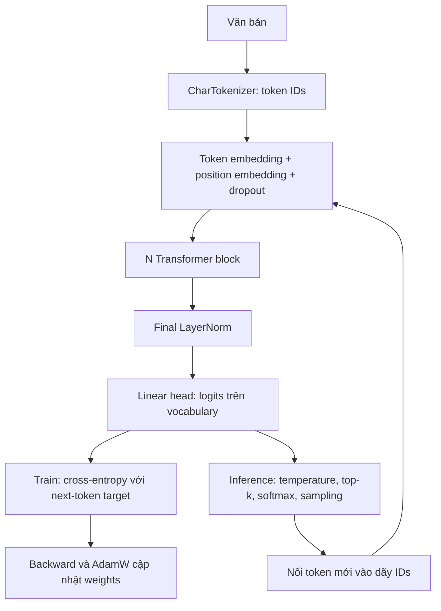

# Báo cáo thực hành: Kiến trúc, pretraining và đánh giá GPT mini

**Module:** `02_llm_internals` — LLM Internals.

**Ngày tổng hợp:** 29/10/2026.

**Implementation:** [mini_gpt.py](mini_gpt.py), sử dụng PyTorch.

**Thực nghiệm chính:** hai checkpoint của [TASK_01_REVIEW.ipynb](TASK_01_REVIEW.ipynb),
huấn luyện 100 và 500 bước trên `sample_corpus.txt`.

## 1. Mục tiêu và phạm vi

Mục tiêu của bài thực hành là hiểu và triển khai một Transformer đơn giản:
giải thích được từng bước từ văn bản đến dự đoán token kế tiếp, chạy pretraining
từ weights ngẫu nhiên, lưu/nạp checkpoint và đánh giá kết quả trên validation.

Báo cáo trình bày theo mạch: **kiến trúc → decoder-only → attention → thông tin
vị trí → mục tiêu pretrain → loss và activation → huấn luyện → inference →
đánh giá**. Các giải thích đối chiếu trực tiếp với class và hàm trong mã nguồn.

Kết quả cho thấy mô hình học được quy luật ký tự của corpus và giảm loss so
với baseline. Tuy nhiên, corpus nhỏ và mẫu sinh còn sai từ, nên bằng chứng
hiện tại chỉ hỗ trợ khả năng language modeling ở quy mô thực hành.

## 2. GPT mini được xây theo kiến trúc nào?

### 2.1. Kiến trúc tổng thể

Mô hình thuộc họ **Transformer decoder-only kiểu GPT-2**, gồm causal multi-head
self-attention, FFN dùng GELU, residual connection và Pre-LayerNorm. Position
embedding là bảng học được; token embedding và output head dùng chung weights.
Đây là một implementation thu nhỏ, không triển khai toàn bộ chi tiết của GPT-2.



Mỗi block có hai nhánh residual, được thực hiện trong `Block.forward`:

```python
x = x + self.attn(self.ln1(x))
x = x + self.mlp(self.ln2(x))
```

Attention trộn thông tin giữa các token; MLP/FFN biến đổi đặc trưng tại từng
token. LayerNorm đặt trước mỗi nhánh nên cấu trúc được gọi là **Pre-LayerNorm**.
Mỗi block có weights riêng và giữ nguyên shape `[B,T,C]` để có thể cộng residual.

### 2.2. Cấu hình được sử dụng

Workspace có hai cấu hình checkpoint khác nhau:

| Thành phần | Model notebook — thực nghiệm chính | `mini_gpt.pt` |
|---|---:|---:|
| Số Transformer block | 2 | 4 |
| Số attention head mỗi block | 4 | 4 |
| Embedding dimension | 64 | 128 |
| Dimension mỗi head | 16 | 32 |
| Context length | 32 | 128 |
| Vocabulary size | 35 | 65 |
| Dropout | 0,1 | 0,1 |
| Số tham số duy nhất | **104.384** | **818.048** |

Toàn bộ bảng kết quả ở phần sau sử dụng model notebook 104.384 tham số.
Các số liệu đó không được gán cho checkpoint `mini_gpt.pt`.

Ký hiệu: `B` là batch size, `T` là số token của một đoạn, `C` là embedding
dimension, `H` là số head và `V` là vocabulary size. Với batch huấn luyện:

| Bước xử lý | Shape |
|---|---|
| Token IDs | `[8,32]` |
| Token embedding + position embedding | `[8,32,64]` |
| Q, K, V sau khi chia head | `[8,4,32,16]` |
| Attention scores/weights | `[8,4,32,32]` |
| Output của mỗi block | `[8,32,64]` |
| Logits sau final norm và head | `[8,32,35]` |

## 3. Decoder-only nghĩa là gì và tại sao chọn kiến trúc này?

Model có nhiệm vụ **viết tiếp một prefix bằng cách dự đoán token kế tiếp**.
Trong decoder-only, chỉ có một luồng token đi qua các block causal self-attention;
không có encoder riêng hoặc cross-attention đến đầu ra của encoder.

| Kiến trúc | Cách xử lý thông tin điển hình |
|---|---|
| Encoder-only | Self-attention hai chiều để tạo biểu diễn đầu vào |
| Encoder-decoder | Encoder biểu diễn nguồn; decoder sinh đích và đọc nguồn qua cross-attention |
| Decoder-only của lab | Causal self-attention trên prefix để dự đoán phần tiếp theo |

“Decoder-only” không có nghĩa model không biến đổi đầu vào: embedding vẫn
chuyển token IDs thành vector. Tên gọi mô tả cấu trúc sinh chuỗi tự hồi quy.

**Causal** nghĩa là tại vị trí `i`, model chỉ đọc được các vị trí `0..i`.
Ví dụ chuỗi gốc là `hello `, trong đó `␠` biểu diễn dấu cách:

```text
Input:             h    e    l    l    o
Target:            e    l    l    o    ␠
Prefix được đọc:   h    he   hel  hell hello
```

Logits ở vị trí `h` dự đoán `e`, logits ở vị trí `o` dự đoán dấu cách. Nếu
không che tương lai, vị trí đầu có thể đọc trực tiếp `e` ở vị trí sau và lộ
đáp án. Khi inference, token tương lai ấy chưa tồn tại.

Khi train, toàn bộ input đã có sẵn nên tính tất cả vị trí song song bằng
ma trận attention có mask. Khi generate, token mới chưa biết nên phải dự đoán,
chọn token rồi mới thực hiện bước kế tiếp.

## 4. Attention hoạt động như thế nào?

### 4.1. Query, Key và Value

Trong `CausalSelfAttention`, đầu vào đã được LayerNorm. Gọi đầu vào đó là `X`:

```text
Q = XWq + bq
K = XWk + bk
V = XWv + bv
```

Q biểu diễn đặc trưng mà một vị trí dùng để tìm thông tin; K dùng để so khớp
với Q; V chứa thông tin sẽ được trộn. Đây là cách diễn giải vai trò, không
phải các nhãn được gán thủ công trong dữ liệu.

Q/K/V là tensor trung gian phụ thuộc input. Wq/Wk/Wv là các weights học được.
Code gộp ba phép chiếu vào `nn.Linear(C, 3*C)`, sau đó tách bằng `split`.
Trong công thức attention, `V` là tensor Value; ở bảng shape tổng thể,
`V` là ký hiệu vocabulary size. Đây là hai đại lượng khác nhau.

### 4.2. Scaled dot-product attention và causal mask

Với mỗi head, tính:

```text
S = QKᵀ / sqrt(d_head)
A = softmax(S + M, dim=-1)
Z = A @ V

M[i,j] = 0     khi j <= i
M[i,j] = -inf  khi j > i
```

`QKᵀ` đo độ phù hợp giữa mỗi query và các key. Chia cho `sqrt(d_head)` giúp
kiểm soát độ lớn scores khi dimension tăng, hạn chế softmax quá bão hòa.
Softmax biến scores thành trọng số trên các vị trí key, rồi `A @ V` lấy tổng
có trọng số của thông tin từ những vị trí được phép đọc.

Mask ba vị trí đầu, hàng là query và cột là key:

```text
       h e l
h      1 0 0
e      1 1 0
l      1 1 1
```

Đặt score tương lai bằng `-inf` trước softmax làm trọng số tương ứng bằng 0.
Đặt score bằng 0 không che được vì `exp(0)=1`. Mask là buffer cố định, không
phải weights học được. Trong eval, mỗi hàng attention weights cộng thành 1;
dropout sau softmax khi train có thể làm tổng hàng sau dropout khác 1.

### 4.3. Multi-head attention

Với embedding 64 chiều và 4 head, mỗi head có 16 chiều. Các head đều đọc
cùng prefix nhưng dùng các phép chiếu riêng trong tensor Q/K/V; chúng không
chia chuỗi đầu vào thành bốn đoạn. Sau attention, output các head được ghép
lại thành 64 chiều rồi chiếu qua `Wo` (`self.proj`).

Ma trận scores có shape `[B,H,T,T]`. Tăng gấp đôi `T` làm số phần tử của
ma trận này tăng bốn lần, là một nguyên nhân khiến context dài tốn bộ nhớ.

## 5. Token embedding và position encoding

`CharTokenizer` dựng vocabulary từ các ký tự xuất hiện trong corpus. Mỗi ký
tự, bao gồm dấu cách và xuống dòng, được ánh xạ sang một ID. ID là chỉ số
tra bảng, không mang quan hệ lớn/nhỏ về ngữ nghĩa. Lab `bpe.py` là thực hành
BPE độc lập và chưa được nối vào GPT này.

Token embedding ánh xạ ID sang vector 64 chiều. Để đưa thông tin vị trí vào
biểu diễn, `GPT.forward` cộng thêm vector lấy từ bảng position embedding:

```python
pos = torch.arange(T, device=idx.device)
x = self.drop(self.tok_emb(idx) + self.pos_emb(pos))
```

Đây là **learned absolute position embedding**: bảng `[block_size,C]` được
khởi tạo và cập nhật bằng gradient. Hai ký tự `l` có cùng token embedding,
nhưng ở hai vị trí sẽ được cộng hai position embedding khác nhau.

Position encoding là tên chung cho cách cung cấp thông tin vị trí. Lựa chọn
của lab là bảng học được, không dùng sinusoidal hoặc RoPE. Với cấu hình nhỏ,
model xử lý tối đa 32 token trong một cửa sổ; khi sinh dài hơn, code giữ 32
token gần nhất và tạo lại position IDs từ 0 trong cửa sổ đó.

## 6. Pretrain objective: mô hình đang học điều gì?

Mục tiêu là **causal language modeling**, tức dự đoán token kế tiếp dựa trên
prefix. Phân phối của một chuỗi có thể được phân rã:

```text
p(t1, ..., tn) = p(t1) × p(t2 | t1) × ... × p(tn | t1, ..., t(n-1))
```

Lab học các xác suất có điều kiện trên những cửa sổ lấy từ corpus; không
dùng BOS riêng để học một phân phối token đầu theo công thức trên. Mỗi cửa
sổ cung cấp nhiều bài toán next-token có context dài dần từ đầu cửa sổ.

`get_batch` tạo input và target lệch nhau một token:

```python
x = data[i : i + block_size]
y = data[i + 1 : i + block_size + 1]
```

Target được lấy trực tiếp từ văn bản nên không cần người gán nhãn. Đây là
học tự giám sát. Các prefix khi train là token thật từ corpus, thường gọi là
teacher forcing; model không phải sinh thử token để tạo input huấn luyện.

Weights được khởi tạo ngẫu nhiên và học từ raw text nên đây là pretraining
từ đầu. Bài thực hành chưa có instruction tuning hoặc preference tuning;
objective hiện tại tối ưu khả năng viết tiếp văn bản.

## 7. Loss được tính như thế nào?

Sau các block và final LayerNorm, Linear head tạo logits `[B,T,V]`. Logits là
điểm số chưa chuẩn hóa cho từng token có thể xuất hiện tiếp theo.

Với logits `z` và target đúng `y` tại một vị trí:

```text
p(y) = exp(z_y) / tổng_v exp(z_v)
loss_position = -ln p(y)
loss_batch = trung bình loss_position trên B × T vị trí
```

Nếu model cho target xác suất 0,1 thì loss khoảng 2,303; nếu tăng lên 0,8 thì
loss khoảng 0,223. Như vậy, giảm loss tương ứng với tăng xác suất dành cho
target đúng trên dữ liệu đang chấm.

Code sử dụng:

```python
loss = F.cross_entropy(
    logits.view(-1, logits.size(-1)),
    targets.view(-1),
)
```

Cross-entropy nhận **logits trực tiếp**, vì hàm đã thực hiện phép tương đương
log-softmax và negative log-likelihood. Không gọi softmax trước loss này.
Với dự đoán đều trên 35 ký tự, baseline loss là `ln(35) ≈ 3,555`.

Perplexity được tính bằng `exp(mean cross-entropy)`. Giá trị thấp hơn nghĩa
là model ít bất định hơn với target được chấm; đây không phải tỷ lệ trả lời
đúng. So sánh perplexity cần giữ cùng dữ liệu, tokenizer và cách tính context.

## 8. Activation và các thành phần trong Transformer block

### 8.1. GELU trong FFN

FFN của mỗi block mở rộng vector 64 → 256, áp dụng GELU rồi thu về 64 chiều:

```python
return self.drop(self.down(F.gelu(self.up(x))))
```

GELU là hàm phi tuyến, `GELU(z) = z × Φ(z)`, với Φ là hàm phân phối tích lũy
chuẩn tắc. Nó biến đổi từng thành phần của vector và không cắt toàn bộ giá
trị âm về 0 như ReLU.

Nếu bỏ GELU, hai lớp Linear của riêng nhánh FFN có thể gộp thành một phép
affine, làm giảm khả năng biến đổi của nhánh này. Toàn model vẫn còn các
phép phi tuyến khác ở attention và LayerNorm.

### 8.2. Phân biệt vai trò các thành phần

| Thành phần | Vai trò |
|---|---|
| GELU | Phi tuyến trong FFN, xử lý đặc trưng tại mỗi vị trí |
| Softmax trong attention | Chuẩn hóa scores trên các vị trí key |
| Softmax khi generate | Chuẩn hóa logits trên vocabulary để chọn token |
| LayerNorm | Chuẩn hóa theo chiều đặc trưng của từng token, có scale/bias học được |
| Residual connection | Giữ đường truyền thông tin và hỗ trợ gradient qua các block |
| Dropout | Regularization khi train; tắt trong chế độ eval |
| Cross-entropy loss | Đánh giá xác suất model dành cho target đúng |

Activation function và loss có vai trò khác nhau: activation biến đổi biểu
diễn bên trong mạng, còn loss cung cấp mục tiêu để tối ưu weights. Từ
“activation” cũng có thể chỉ một tensor trung gian như Q hoặc hidden state.

## 9. Quy trình pretraining đã thực hiện

### 9.1. Dữ liệu và cấu hình huấn luyện

Corpus [sample_corpus.txt](sample_corpus.txt) có **2.004 ký tự**, vocabulary
**35 ký tự**. Dữ liệu được chia liên tục: **1.803 token đầu cho train**, **201
token cuối cho validation**. Vocabulary được dựng từ toàn corpus, nhưng
weights chỉ được cập nhật trên train split.

| Thiết lập | Giá trị |
|---|---|
| Kiến trúc | 2 block, 4 head, embedding 64, context 32 |
| Batch size | 8 |
| Ngân sách | Hai lần khởi tạo mới: 100 và 500 updates |
| Optimizer | AdamW, weight decay 0,01 |
| Learning rate cơ sở | 0,003 |
| Scheduler | Warmup và cosine decay, phụ thuộc tổng số bước |
| Gradient clipping | Norm tối đa 1,0 |
| Dropout | 0,1 |
| Seed | 1337 |
| Thiết bị | CPU, 4 thread |
| Môi trường trong metadata | Python 3.11.9, PyTorch 2.14.1, macOS ARM64 |

Hai lần chạy dùng cùng seed, kiến trúc và corpus; lần 500 bước không tiếp
tục từ checkpoint 100 bước. Vì scheduler phụ thuộc `steps`, phép so sánh này
bao gồm cả thay đổi thời lượng schedule, chưa cô lập riêng tác động số bước.

### 9.2. Training loop và cập nhật weights

Mỗi bước thực hiện:

```text
Lấy batch x,y → forward → cross-entropy
→ zero_grad → backward → clip gradient → AdamW.step → scheduler.step
```

`loss.backward()` tính gradient đối với các tham số; `optimizer.step()` mới
cập nhật weights. Các bảng embedding, Q/K/V projections, output projection,
FFN và các tham số LayerNorm đều được học. Head dùng chung weight với token
embedding nên không được đếm thành một bộ weight riêng.

Một batch `[8,32]` chấm 256 target. `steps=500` là 500 lần cập nhật, không phải
500 epoch; các cửa sổ được lấy ngẫu nhiên và có thể chồng lấn/lặp lại.

Định kỳ, `estimate_loss` chuyển model sang eval và chấm 20 batch ngẫu nhiên
cho mỗi split với no-grad, sau đó trở lại train. Validation không cập nhật
weights. Sau huấn luyện, checkpoint lưu `model`, `config` và `chars`; format
hiện tại không lưu optimizer/scheduler state để tiếp tục chính xác quá trình train.

## 10. Inference flow: sinh văn bản từ checkpoint

Quy trình inference sử dụng cùng kiến trúc và weights đã học:

1. Nạp weights, config và vocabulary từ checkpoint; gọi `model.eval()`.
2. Encode prompt thành token IDs và chạy không gradient.
3. Giữ tối đa 32 token gần nhất, forward để lấy logits `[1,T,35]`.
4. Lấy `logits[:, -1, :]` vì vị trí cuối dự đoán token sau toàn bộ prompt.
5. Chia logits cho temperature, áp dụng top-k nếu được cấu hình.
6. Softmax trên vocabulary, sample token rồi nối ID mới vào input.
7. Lặp đến đủ số token mới; decode dãy IDs thành văn bản.

Ví dụ prompt `hello ` được encode một lần. Sau khi chọn một token mới, code
nối ID trực tiếp vào dãy, không cần tokenize lại văn bản ở từng bước.

Temperature nhỏ hơn 1 làm phân phối sắc hơn; lớn hơn 1 làm phân phối phẳng
hơn. Temperature không làm thay đổi weights. Hàm probe yêu cầu temperature
lớn hơn 0. Model dừng theo số token yêu cầu; chưa có EOS riêng nên có thể
dừng giữa một từ hoặc một câu.

`eval()` tắt dropout; `no_grad()` tắt dựng graph gradient. Hai cơ chế này độc
lập. Implementation hiện forward lại toàn cửa sổ mỗi bước, chưa có KV cache.

| Khi train | Khi generate |
|---|---|
| Có input và target từ corpus | Chỉ cần prompt và weights |
| Chấm logits ở mọi vị trí | Dùng logits vị trí cuối để chọn token mới |
| Prefix gồm các token thật | Prefix dần chứa token model tự sinh |
| Có backward và optimizer update | Không cập nhật weights |

## 11. Kết quả thực nghiệm và đánh giá

### 11.1. Train/validation loss trong log huấn luyện

| Ngân sách | Train đầu | Val đầu | Train cuối | Val cuối |
|---|---:|---:|---:|---:|
| 100 bước | 3,593 | 3,591 | 2,306 | 2,347 |
| 500 bước | 3,593 | 3,591 | 1,532 | 2,373 |

Loss ban đầu gần baseline đoán đều `ln(35) ≈ 3,555`. Cả hai lần chạy đều giảm
loss so với khởi tạo, cho thấy model học được quy luật thống kê trong corpus.

Trong lần chạy 500 bước, validation loss thấp nhất trong các mốc ghi log là
**2,318 ở bước 100**. Train loss sau đó tiếp tục giảm trong khi val dao động,
phù hợp với dấu hiệu overfitting. Script chỉ lưu weights cuối: `model_500.pt`
chứa weights bước 500, không phải weights tại mốc validation tốt nhất.

### 11.2. Đánh giá lại checkpoint trên cùng tập target

Ngày 29/10/2026, hai checkpoint được chấm lại bằng `probe_model.evaluate`.
Dùng 201 ký tự của validation, chấm **200 next-character target**, mỗi target
một lần, với tối đa 32 token đứng trước. Ở đầu validation, context chưa đủ
32 token; hàm không lấy thêm prefix từ train split.

| Model/baseline | Cross-entropy ↓ | Perplexity ↓ | Top-1 ký tự ↑ | Top-5 ký tự ↑ |
|---|---:|---:|---:|---:|
| Đoán đều 35 ký tự | 3,5553 | 35,000 | — | — |
| Unigram từ train, cộng 1 làm trơn | 2,9565 | 19,231 | — | — |
| Checkpoint 100 bước | **2,3585** | **10,575** | 30,5% | 72,5% |
| Checkpoint 500 bước | 2,3914 | 10,929 | **35,5%** | 71,0% |

Unigram chỉ dùng tần suất ký tự trên train, không dùng context:
`p(c) = (count_train(c)+1)/(N_train+V)`. Cả hai model có loss thấp hơn baseline
unigram trên tập target này, cho thấy dự đoán tốt hơn việc chỉ dùng tần suất ký tự.

Checkpoint 500 bước có top-1 cao hơn nhưng loss xấu hơn. Top-1 chỉ xem token
đứng đầu có đúng không; cross-entropy còn tính xác suất gán cho target. Những
lần dự đoán sai với độ tự tin cao có thể tăng loss dù tổng số lần top-1 đúng tăng.

Val loss 2,373 trong log và 2,3914 khi chấm lại không mâu thuẫn: log trung
bình các cửa sổ ngẫu nhiên, còn bảng này chấm một lần mỗi target với context
trượt. Kết quả của hai phương pháp cần được trình bày riêng.

### 11.3. Mẫu sinh thực tế

Cùng prompt `hello `, sampling seed 42, temperature 0,8, không bật top-k,
sinh thêm 60 token từ mỗi checkpoint:

**100 bước:**

```text
hello ppipas e feuut benct pace tis ge in o e in tited denk as tin
```

**500 bước:**

```text
hello putput enge ut odel mppde the weights cores iter o bemald th
```

Mẫu có dấu cách và các cụm ký tự giống corpus, nhưng còn nhiều từ sai và
thiếu ý nghĩa. Metrics tốt hơn baseline chưa chứng minh model tạo văn bản
đúng ngữ pháp hoặc trả lời câu hỏi tốt. Top-1 ký tự 35,5% cũng không phải tỷ
lệ trả lời câu hỏi đúng.

### 11.4. Kiểm tra tính đúng của implementation

Lần kiểm chứng ngày 29/10/2026 chạy hai file test và ghi nhận **11 passed**:

- Tokenizer round-trip và input/target dịch đúng một token.
- Thay token tương lai không làm đổi logits của prefix trong eval.
- Gradient đi qua token/position embedding, attention và FFN.
- CLI có thể train, lưu/nạp checkpoint và sinh văn bản.
- Probe từ chối ký tự ngoài vocabulary; kiểm tra cách chấm và tính tái lập.

Kiểm tra thêm với prompt `hello `: attention ở block đầu có shape `[1,4,6,6]`,
trọng số tương lai bằng 0. Forward được tính lại thủ công qua các layer cho
logits trùng forward của model, sai khác lớn nhất bằng 0 trong lần kiểm tra.
Các kiểm tra này xác nhận những hành vi kỹ thuật; chất lượng ngôn ngữ được
đánh giá bằng metrics và mẫu sinh ở trên.

## 12. Kết luận, hạn chế và hướng phát triển

Bài thực hành đã có một causal language model hoạt động từ tokenizer, token/
position embedding, masked multi-head attention, FFN/GELU đến logits và
cross-entropy. Pipeline có thể pretrain từ đầu, lưu/nạp checkpoint và sinh
văn bản tự hồi quy. Kết quả validation tốt hơn uniform và unigram baseline
trên dữ liệu đã chấm.

Các giới hạn chính là corpus chỉ 2.004 ký tự, validation 201 ký tự cùng chủ
đề, một seed và context 32. Vocabulary được dựng từ toàn corpus nên chưa
phải thiết lập đánh giá tokenizer độc lập trên dữ liệu mới. Cửa sổ train/val
có thể lặp hoặc chồng lấn trong mỗi split; mẫu sinh còn sai từ và ngữ pháp.
Các giới hạn này chưa cho phép suy rộng kết quả sang corpus khác hoặc tác vụ chatbot.

Các bước tiếp theo có thể kiểm chứng:

| Cải tiến | Cách đánh giá |
|---|---|
| Lưu checkpoint có validation loss tốt nhất | Chấm best checkpoint và final checkpoint bằng cùng một evaluator |
| Bổ sung dữ liệu và tập test độc lập | Giữ cấu hình, đo trên dữ liệu chưa dùng để chọn model |
| Chạy nhiều seed | Báo cáo trung bình và độ dao động của validation/test loss |
| Tự viết lại từng thành phần | Chạy các test causal/gradient/checkpoint và đối chiếu forward |

Để giải thích được mô hình trong review, cần nối được ba ý: **causal mask giữ
đúng bài toán next-token; cross-entropy tạo tín hiệu học cho weights; inference
lặp dự đoán và nối token bằng chính những weights đã học**.

## Phụ lục A. Bằng chứng và lệnh tái hiện

Các đường dẫn tính từ thư mục module `02_llm_internals/`:

| Bằng chứng | File |
|---|---|
| Source kiến trúc, train và generate | [mini_gpt.py](mini_gpt.py) |
| Nạp checkpoint, xác suất và evaluator | [probe_model.py](probe_model.py) |
| Notebook thực nghiệm | [TASK_01_REVIEW.ipynb](TASK_01_REVIEW.ipynb) |
| Log train | [100 bước](out/notebook_task01/train_100.log), [500 bước](out/notebook_task01/train_500.log) |
| Cấu hình, môi trường và hash nguồn/corpus của lần train | [metadata.json](out/notebook_task01/metadata.json) |
| Đánh giá lại, mẫu sinh, hash checkpoint và forward checks | [evidence.json](out/understand_gpt_20261029/evidence.json) |
| Checkpoint | `out/notebook_task01/model_100.pt`, `out/notebook_task01/model_500.pt` |

Log/metadata huấn luyện ghi nhận lần chạy ngày 26/10/2026. Bảng đánh giá lại
ở mục 11.2 dùng kết quả ngày 29/10/2026; hash hai checkpoint khớp file bằng
chứng tại thời điểm tổng hợp báo cáo. Artifacts trong `out/` bị Git bỏ qua;
sau clone có thể tái tạo bằng notebook. Các bảng trong báo cáo lưu đủ số liệu
để đọc phần phân tích độc lập với những artifacts này.

Chạy từ `course/` với môi trường `.venv` đã có `torch` và `pytest`:

```bash
source .venv/bin/activate
python -m pytest 02_llm_internals/test_mini_gpt.py 02_llm_internals/test_probe_model.py -q

python 02_llm_internals/probe_model.py \
  --checkpoint 02_llm_internals/out/notebook_task01/model_500.pt \
  --eval-text 02_llm_internals/sample_corpus.txt --split val \
  --prompt "hello " --new-tokens 60 --temperature 0.8 --seed 42
```

Đổi checkpoint sang `model_100.pt` để chấm bằng cùng phương pháp. Muốn tái
hiện cả hai lần train và biểu đồ, chạy notebook từ đầu. Lệnh CLI cho một lần
train mới với cấu hình tương ứng, lưu vào output riêng:

```bash
python -u 02_llm_internals/mini_gpt.py \
  --data 02_llm_internals/sample_corpus.txt --device cpu \
  --n_layer 2 --n_head 4 --n_embd 64 --block_size 32 \
  --batch_size 8 --steps 100 --lr 0.003 --dropout 0.1 \
  --log_every 25 --sample_tokens 60 \
  --out 02_llm_internals/out/report_reproduce/model_100.pt
```

CPU thread count và môi trường có thể ảnh hưởng thời gian và sai khác số học;
metadata của notebook ghi 4 thread. Lệnh này không ghi đè checkpoint dùng
cho các bảng số liệu trong báo cáo.

## Phụ lục B. Mạch trình bày review 5–7 phút

| Thời lượng | Nội dung trình bày | Phần báo cáo |
|---|---|---|
| 1 phút | Mục tiêu next-token, kiến trúc và cấu hình | Mục 1–2 |
| 1–2 phút | Ví dụ input/target, causal mask, Q/K/V, position embedding | Mục 3–5 |
| 1 phút | Objective, cross-entropy, GELU và cách cập nhật weights | Mục 6–9 |
| 1 phút | Reload checkpoint và vòng lặp sinh token | Mục 10 |
| 1–2 phút | Loss/accuracy, mẫu sinh, overfitting và cải tiến | Mục 11–12 |

## Tài liệu tham khảo

- [Mã nguồn GPT mini](mini_gpt.py) và [bộ evaluator](probe_model.py): nguồn
  chính để đối chiếu implementation và cách đo trong báo cáo.
- Vaswani và cộng sự, [Attention Is All You Need, mục 3](https://arxiv.org/html/1706.03762v7#S3):
  scaled dot-product attention, multi-head attention và Transformer.
- Radford và cộng sự, [Language Models are Unsupervised Multitask Learners, mục 2.3](https://cdn.openai.com/better-language-models/language_models_are_unsupervised_multitask_learners.pdf):
  kiến trúc GPT-2 và thay đổi vị trí LayerNorm.
- [PyTorch CrossEntropyLoss](https://docs.pytorch.org/docs/2.14/generated/torch.nn.CrossEntropyLoss.html):
  đầu vào logits và cách tính cross-entropy.
