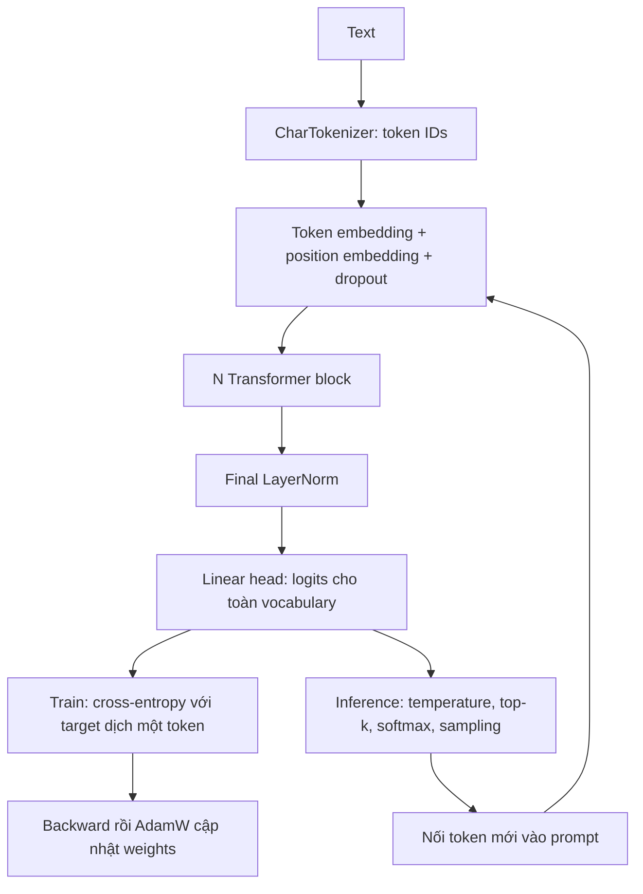

# Hiểu GPT mini để tự code và trình bày review

Bài đã train được. Bước tiếp theo là tự giải thích và viết lại đường đi
**text → logits → loss → cập nhật weights**, rồi **prompt → token mới**.
Đọc tài liệu này cùng [mini_gpt.py](mini_gpt.py); dùng
[TASK_01_REVIEW.ipynb](TASK_01_REVIEW.ipynb) để mở bằng chứng chạy thực tế.
Hướng dẫn setup và tra cứu từng hàm vẫn ở [TASK_01_FULL_GUIDE.md](TASK_01_FULL_GUIDE.md).

**Bản báo cáo để trình bày:** [GPT_MINI_REPORT.md](GPT_MINI_REPORT.md) tổng hợp
kiến trúc, cơ chế học/sinh token, kết quả thực nghiệm và phần phân tích theo
cùng mạch nội dung, kèm bằng chứng và kịch bản review 5–7 phút.

## 1. Chính xác mình đang có model gì?

Implementation là **Transformer decoder-only kiểu GPT-2, dùng Pre-LayerNorm**:
causal multi-head self-attention, FFN/GELU, residual, learned absolute position
embedding và input/output weight tying. Đây là model tự train của lab.

Kiểm tra checkpoint tại workspace ngày **29/10/2026** cho thấy hai cấu hình:

| Checkpoint | Block | Head | Embedding | Context | Vocabulary | Tham số duy nhất |
|---|---:|---:|---:|---:|---:|---:|
| `out/notebook_task01/model_100.pt`, `model_500.pt` | 2 | 4 | 64 | 32 | 35 | 104.384 |
| `mini_gpt.pt` | 4 | 4 | 128 | 128 | 65 | 818.048 |

Cùng class `GPT` nhưng khác cấu hình và weights. Các ví dụ bên dưới dùng
**model notebook 104.384 tham số**. Không lấy số liệu của nó gán cho `mini_gpt.pt`.
Các checkpoint/output này bị Git bỏ qua; sau clone cần tạo lại theo notebook.



Khi inference, chuỗi đã là token IDs được nối trực tiếp và đưa lại vào model;
không cần decode rồi tokenize lại ở mỗi bước. Một block được viết đúng như sau:

```python
x = x + attention(layer_norm_1(x))
x = x + mlp(layer_norm_2(x))
```

Hai phép cộng giữ cùng shape. Hai block là **hai bộ weights riêng**, không
phải dùng cùng một block hai lần. Pre-LayerNorm nghĩa là norm trước attention/MLP.

## 2. Decoder-only nghĩa là gì?

Model đọc một prefix và dự đoán token kế tiếp. Ở vị trí `i`, self-attention
chỉ được truy cập các vị trí `0..i`. Chữ **causal** diễn tả giới hạn này.

| Kiểu Transformer | Luồng điển hình |
|---|---|
| Encoder-only | Self-attention hai chiều để biểu diễn một chuỗi đầu vào |
| Encoder-decoder | Encoder đọc nguồn; decoder sinh đích và cross-attend tới nguồn |
| Decoder-only của lab | Một luồng token, causal self-attention, sinh tiếp prefix |

Trong lab không có encoder hoặc cross-attention. “Decoder” ở đây chỉ họ
kiến trúc sinh tự hồi quy; model vẫn có embedding để biến token IDs thành vector.

Ví dụ văn bản thật là `hello `, gồm cả dấu cách cuối:

```text
input x:    h  e  l  l  o
target y:   e  l  l  o  ␠
context:    h  he hel hell hello
```

Logits tại `h` học dự đoán `e`; logits tại `o` học dự đoán dấu cách.
Không che tương lai thì vị trí `h` có thể đọc trực tiếp `e` trong input:
lộ đáp án khi train. Lúc sinh văn bản thật, `e` đó chưa có.

**Vì sao train vẫn song song được?** Toàn bộ `x` đã biết, nên tính tất cả
vị trí trong một forward với mask. Khi inference, token mới chưa biết,
nên phải sinh lần lượt. Đây là teacher forcing: train dùng prefix thật từ corpus.

## 3. Token embedding và position encoding

`CharTokenizer` ánh xạ từng ký tự có trong corpus sang ID. ID là chỉ số;
ID lớn hơn không có nghĩa ký tự “quan trọng hơn”. `bpe.py` là bài riêng,
chưa được nối vào model này.

Với `B=8, T=32, C=64, V=35`:

```text
idx                    [8, 32]       số nguyên
tok_emb(idx)           [8, 32, 64]   vector tra từ bảng [35, 64]
pos_emb(arange(T))         [32, 64]   vector tra từ bảng [32, 64]
tok_emb + pos_emb       [8, 32, 64]   broadcast theo batch
```

Cùng ký tự `l` ở hai vị trí lấy cùng vector token, nhưng cộng hai vector
vị trí khác nhau. Position embedding đưa vị trí vào biểu diễn; attention
sau đó có thể học dùng thông tin ấy để xử lý thứ tự.

**Position encoding** là tên chung cho cách đưa thông tin vị trí vào model.
Lab chọn **learned absolute position embedding**: một bảng có weights và
được cập nhật bằng gradient. Nó không dùng sinusoidal hoặc RoPE.
`block_size=32` là giới hạn cửa sổ của cấu hình nhỏ, không phải số ký tự tối đa
của toàn bộ văn bản sinh ra.

## 4. Attention: mỗi token lấy thông tin từ đâu?

Đọc `CausalSelfAttention.forward`. Đầu vào attention là `LayerNorm(x)`.
Từ biểu diễn đó, ba phép chiếu học được tạo Q, K, V:

| Đại lượng | Cách hiểu để nhớ | Vai trò toán học |
|---|---|---|
| Query Q | Tôi đang tìm gì? | So khớp với K của các vị trí được phép đọc |
| Key K | Tôi có thể được tìm theo đặc điểm nào? | Nhận điểm phù hợp từ Q |
| Value V | Tôi cung cấp thông tin gì? | Nội dung được trộn theo attention weights |

Đây là cách diễn giải; không có nhãn thủ công quy định mỗi head phải học gì.
Q/K/V là **activation tính lại theo input**; các ma trận chiếu Wq/Wk/Wv mới
là weights được lưu trong checkpoint. Code gộp ba phép chiếu trong `qkv`.

```text
Q, K, V = projections(LayerNorm(x))
scores  = Q @ Kᵀ / sqrt(d_head)
scores[i,j] = -inf nếu j > i
A       = softmax(scores, dim=-1)
output  = A @ V
```

`Q @ Kᵀ` so mỗi query với các key. Chia `sqrt(d_head)` giúp kiểm soát độ lớn
điểm khi chiều head tăng; điểm quá lớn dễ làm softmax bão hòa.
Đặt `-inf` trước softmax cho trọng số tương lai bằng 0. Đặt score bằng 0
không che được vì `exp(0)=1`.

Mask ba vị trí đầu, hàng là query, cột là key:

```text
        h e l
h       1 0 0
e       1 1 0
l       1 1 1
```

Mask là buffer cố định, không học bằng gradient. Trong chế độ eval, mỗi hàng
của A cộng thành 1. Khi train, code còn dropout sau softmax nên tổng hàng
sau dropout không nhất thiết bằng 1.

**Multi-head:** chia `C=64` thành `H=4` head, mỗi head `D=16`:

```text
Q/K/V                 [8, 4, 32, 16]
Q @ Kᵀ và A           [8, 4, 32, 32]
A @ V                 [8, 4, 32, 16]
ghép head, chiếu Wo   [8, 32, 64]
```

Các head cùng truy cập prefix nhưng có phép chiếu khác nhau. Không chia
chuỗi thành bốn phần cho bốn head. Ở model 818.048 tham số, mỗi head có
`128 / 4 = 32` chiều. Ma trận attention có `T × T` phần tử cho mỗi head,
vì vậy tăng gấp đôi context làm số phần tử ma trận này tăng bốn lần.

## 5. FFN, activation, residual và LayerNorm

Attention trộn thông tin **giữa các vị trí**; FFN xử lý vector **tại từng vị trí**,
dùng chung weights FFN trên các vị trí:

```python
ffn_output = down(gelu(up(x)))  # 64 → 256 → 64
```

GELU là activation phi tuyến, `GELU(z) = z * Φ(z)`, với Φ là CDF chuẩn tắc.
Nó biến đổi từng giá trị; số âm không bị cắt hết như ReLU. Nếu bỏ GELU,
hai lớp Linear của FFN có thể gộp thành một phép affine, làm giảm khả năng
biến đổi của riêng nhánh FFN. Toàn model vẫn còn phi tuyến ở attention và norm.

| Thành phần | Làm gì trong lab? |
|---|---|
| GELU | Tạo phi tuyến cho FFN |
| Softmax trong attention | Phân phối trọng số trên **các vị trí key** |
| Softmax lúc sinh | Phân phối xác suất trên **các token trong vocabulary** |
| LayerNorm | Chuẩn hóa theo chiều C của từng token, có scale/bias học được |
| Residual `x + f(x)` | Giữ đường truyền thông tin và giúp gradient đi qua các block |
| Dropout | Regularization khi train; tắt bằng `model.eval()` |

“Activation” còn có thể chỉ tensor trung gian, ví dụ Q hoặc hidden state.
**Loss** là đại lượng chấm dự đoán sai bao nhiêu; **activation function**
là phép biến đổi bên trong mạng. Hai khái niệm có vai trò khác nhau.

## 6. Pretrain objective và cross-entropy loss

Mục tiêu là học phân phối next-token:

```text
p(text) = tích các p(token kế tiếp | prefix)
loss    = trung bình của -ln p(target đúng | prefix)
```

Đây là causal language modeling tự giám sát: corpus tự cung cấp target bằng
cách dịch một token. Lab khởi tạo weights ngẫu nhiên rồi học từ raw text,
nên là pretraining từ đầu. Chưa có bước instruction tuning hoặc preference tuning.

`GPT.forward` tạo logits `[B,T,V]`, sau đó flatten để chấm mọi vị trí:

```python
loss = F.cross_entropy(logits.view(-1, V), targets.view(-1))
```

Logits là điểm thực, chưa chuẩn hóa. Cross-entropy nhận **logits trực tiếp**;
nó đã thực hiện phép tương đương log-softmax rồi lấy negative log-likelihood
theo target. Không softmax trước khi đưa vào hàm này.
[PyTorch CrossEntropyLoss](https://docs.pytorch.org/docs/2.14/generated/torch.nn.CrossEntropyLoss.html).

Nếu xác suất dành cho target là 0,1 thì loss tại vị trí đó là 2,303; nếu là
0,8 thì loss là 0,223. Tăng xác suất của đáp án đúng giúp giảm loss.
Đoán đều trên 35 ký tự cho loss `ln(35) = 3,555`.

Training loop thực hiện:

```text
lấy batch x,y → forward → loss
→ zero_grad → backward → clip gradient → AdamW.step → scheduler.step
```

`backward()` tính gradient; `optimizer.step()` mới đổi weights. Embedding,
position embedding, attention, FFN và LayerNorm đều có tham số được học.
Head dùng chung weight với token embedding nên không tính hai lần khi đếm tham số.
Validation chỉ forward trong eval/no-grad, không cập nhật weights.

Một batch `[8,32]` tạo 256 target được chấm. `steps=500` là 500 lần cập nhật,
không phải 500 epoch; cửa sổ được lấy ngẫu nhiên và có thể lặp/chồng lấn.

## 7. Inference flow: từ prompt đến văn bản

Đọc `GPT.generate` và `probe_model.continue_text`:

1. Nạp **weights + config + vocabulary** từ cùng checkpoint.
2. Encode prompt, gọi `model.eval()` và chạy không gradient.
3. Giữ tối đa `block_size` token gần nhất, forward lấy logits `[1,T,V]`.
4. Chỉ lấy `logits[:, -1, :]`: vị trí cuối dự đoán token kế tiếp prompt.
5. Chia logits cho temperature; có top-k thì che các token ngoài nhóm k.
6. Softmax trên vocabulary, sample một token, nối vào input rồi lặp.
7. Decode dãy IDs thành text.

Temperature nhỏ hơn 1 làm phân phối sắc hơn; lớn hơn 1 làm nó phẳng hơn.
Hàm này yêu cầu temperature **lớn hơn 0**. Muốn greedy với CLI hiện có,
dùng `--top-k 1`; không truyền temperature bằng 0.

Train chấm tất cả vị trí với target thật. Generate lấy vị trí cuối và dùng
token vừa sinh làm input bước sau. Code hiện tính lại cả cửa sổ mỗi bước,
chưa có KV cache. Khi crop, position IDs được tạo lại từ 0 trong cửa sổ.
Không có EOS token riêng; model dừng theo `max_new_tokens`, có thể cắt giữa câu.

`eval()` tắt dropout; `no_grad()` tắt dựng graph gradient. Hai việc này độc lập.
Inference thông thường không cập nhật weights và không cần biết target.

## 8. Đánh giá kết quả đã train như thế nào?

Đánh giá lại ngày **29/10/2026**, dùng hai checkpoint của notebook và 201 ký tự
cuối `sample_corpus.txt`. Chấm mỗi next-character target đúng một lần: **200
target**, context tối đa 32. Hàm dùng là `probe_model.evaluate`.

| Model/baseline | Cross-entropy ↓ | Perplexity ↓ | Top-1 ký tự ↑ |
|---|---:|---:|---:|
| Đoán đều 35 ký tự | 3,5553 | 35,000 | — |
| Unigram từ train, cộng 1 làm trơn | 2,9565 | 19,231 | — |
| Checkpoint 100 bước | 2,3585 | 10,575 | 30,5% |
| Checkpoint 500 bước | 2,3914 | 10,929 | 35,5% |

Unigram chỉ dùng tần suất ký tự trên train, không đọc context; làm trơn bằng
`p(c) = (count_train(c)+1)/(N_train+V)`. Cả hai checkpoint có loss thấp hơn
hai baseline trên lát đánh giá này. Perplexity là `exp(mean loss)`, có thể
hiểu như độ bất định hiệu dụng; không phải số token được sinh ra hay tỷ lệ đúng.

**Vì sao top-1 tăng mà loss lại xấu hơn?** Top-1 chỉ chấm token đứng đầu có
đúng không. Cross-entropy còn chấm xác suất dành cho target; dự đoán sai với
độ tự tin cao có thể bị phạt nặng dù số vị trí đứng đầu đúng tăng.

Log train cũ cho checkpoint 500 bước: train loss 3,593 → 1,532, còn val loss
3,591 → 2,373. Train tiếp tục tốt hơn trong khi val chững lại là dấu hiệu
phù hợp với overfitting. Val nhỏ, một seed và cửa sổ chồng lấn làm kết luận
tổng quát còn hạn chế. Hai ngân sách 100/500 còn có schedule khác nhau vì
scheduler phụ thuộc tổng số bước.

Val loss 2,373 trong log không cần bằng 2,3914 ở bảng: log lấy 20 batch cửa sổ
ngẫu nhiên; bảng chấm một lần mỗi target với context trượt. Hai cách lấy mẫu
khác nhau. So sánh model phải giữ cùng corpus, tokenizer và cách đánh giá.
Top-1 ký tự 35,5% không phải tỷ lệ trả lời câu hỏi đúng.

Các test kỹ thuật đã chạy: **11 passed** cho `test_mini_gpt.py` và
`test_probe_model.py`. Test kiểm tra causal behavior, gradient, checkpoint và
cách chấm; chất lượng ngôn ngữ được đánh giá bằng metrics và mẫu sinh riêng.
Số liệu chi tiết, hash và kiểm tra attention ở
`out/understand_gpt_20261029/evidence.json` tại workspace này.

Tái hiện bằng lệnh có sẵn, chạy từ `course/` sau khi activate `.venv`:

```bash
python 02_llm_internals/probe_model.py \
  --checkpoint 02_llm_internals/out/notebook_task01/model_500.pt \
  --eval-text 02_llm_internals/sample_corpus.txt --split val \
  --prompt "hello " --new-tokens 80 --temperature 0.8 --seed 42
```

Thay `model_500.pt` bằng `model_100.pt` để so sánh trên cùng dữ liệu.
Không dùng `--split all` trên corpus gốc để gọi đó là điểm validation.

## 9. Bốn buổi ngắn để tự viết lại được

Mỗi buổi khoảng 45–60 phút, đọc rồi đóng source khi viết lại. Lưu bản tập
trong `out/rebuild/mini_gpt.py` để không ghi đè lab đang dùng.

| Buổi | Phần tự viết | Bằng chứng hiểu |
|---|---|---|
| 1 | `Config`, `CharTokenizer`, `get_batch`, token/position embedding | Giải thích `hello → ello␠`, in đúng shape và round-trip |
| 2 | `CausalSelfAttention`, `MLP`, `Block` | Vẽ mask 4×4; thay tương lai không đổi logits prefix |
| 3 | `GPT.forward`, cross-entropy, training loop | Loss ban đầu gần ln(V); backward có gradient; chạy pretrain nhỏ |
| 4 | Save/load, generate, đánh giá | Reload sinh được; báo cáo train/val, perplexity và giới hạn |

Gợi ý tự kiểm: giữ API tương tự lab và chạy bản sao test với implementation
của bạn. Từ `course/`:

```bash
mkdir -p 02_llm_internals/out/rebuild
cp 02_llm_internals/test_mini_gpt.py 02_llm_internals/out/rebuild/test_mini_gpt.py
# Tự viết out/rebuild/mini_gpt.py rồi chạy:
python -m pytest 02_llm_internals/out/rebuild/test_mini_gpt.py -q
```

Chạy pretrain bản tự viết với cấu hình nhỏ, đặt output riêng:

```bash
python 02_llm_internals/out/rebuild/mini_gpt.py \
  --data 02_llm_internals/sample_corpus.txt --device cpu \
  --n_layer 2 --n_head 4 --n_embd 64 --block_size 32 \
  --batch_size 8 --steps 100 --lr 0.003 --dropout 0.1 \
  --log_every 25 --sample_tokens 80 \
  --out 02_llm_internals/out/rebuild/model_100.pt
```

Lệnh này giả định bản tự viết giữ CLI của lab. Dùng `probe_model.py` chấm
checkpoint mới theo mục 8 nếu giữ cùng định dạng weights/config/chars.
Test và loss giảm là mốc kiểm tra; tự giải thích được từng bước mới là mục
tiêu học. Không cần thêm capacity hoặc chạy train dài để bắt đầu hiểu kiến trúc.

## 10. Kịch bản review 5–7 phút và câu hỏi tự kiểm

- **Phút 1:** “Em xây causal language model, dùng decoder-only để dự đoán
  ký tự kế tiếp. Model notebook có 2 block, 4 head, 104.384 tham số.”
- **Phút 2:** Chỉ ví dụ `hello → ello␠`, token embedding và position embedding.
- **Phút 3–4:** Vẽ causal mask, giải thích Q/K/V, scale, softmax, rồi FFN/GELU
  và hai residual trong một block. Theo dõi `[B,T,C]` đến `[B,T,V]`.
- **Phút 5:** Chỉ cross-entropy, backward và AdamW; giải thích target tự sinh
  từ text và sự khác biệt train/validation.
- **Phút 6:** Mở bảng loss/mẫu sinh; nêu loss giảm, dấu hiệu overfitting và
  giới hạn của corpus nhỏ. Demo reload checkpoint rồi generate.
- **Phút 7:** Nêu phần bản thân tự viết, một lỗi đã kiểm chứng và cải tiến
  tiếp theo, chẳng hạn lưu checkpoint có validation loss tốt nhất.

Đóng tài liệu và thử trả lời:

1. Vì sao model biết toàn input khi train mà vẫn không lộ đáp án?
2. Vì sao hai chữ `l` có cùng token embedding mà hidden state vẫn khác?
3. Q/K/V khác Wq/Wk/Wv thế nào? Tại sao không dùng score 0 để che tương lai?
4. Attention softmax và output softmax chuẩn hóa trên hai tập nào?
5. Vì sao phải có GELU trong FFN? Hai residual cộng những tensor nào?
6. Nếu target được xác suất 0,8, loss của vị trí đó khoảng bao nhiêu?
7. `loss.backward()` và `optimizer.step()` khác nhau thế nào?
8. Vì sao train chấm mọi vị trí còn generate chỉ lấy vị trí cuối?
9. Tại sao 500 bước có thể có train loss tốt hơn nhưng validation xấu hơn?
10. Mẫu sinh giống tiếng Anh đã đủ kết luận model làm chatbot được chưa?

Đối chiếu kiến trúc nền ở [Attention Is All You Need, mục 3](https://arxiv.org/html/1706.03762v7#S3)
và Pre-LayerNorm ở [báo cáo GPT-2, mục 2.3](https://cdn.openai.com/better-language-models/language_models_are_unsupervised_multitask_learners.pdf).
Lab dùng decoder-only và GELU; không sao chép nguyên encoder-decoder/ReLU
của Transformer gốc, cũng không triển khai đầy đủ mọi chi tiết của GPT-2.
