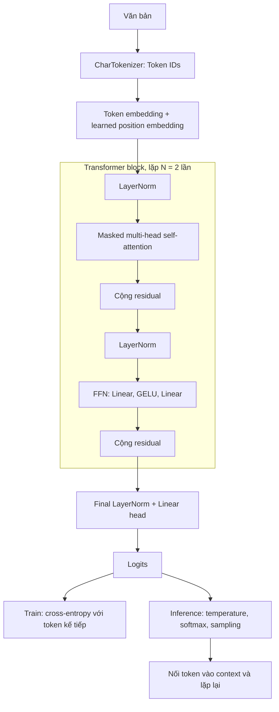

# Báo cáo review — Mini Transformer decoder-only

Ngày kiểm chứng: **26/10/2026**. Người trình bày: **[điền họ tên]**.

Báo cáo ghi nhận mã nguồn lab hiện có trong repository, các bổ sung hỗ trợ
thực hành và các lần kiểm chứng do trợ lý Codex chạy. Người nộp bổ sung phần
tự cài đặt/thay đổi và tự giải thích kiến trúc trong buổi review; kết quả chạy
không thay thế việc xác nhận năng lực cá nhân.

## 1. Mục tiêu và đối chiếu yêu cầu

Mục tiêu: xây một mô hình ngôn ngữ nhỏ, dự đoán token tiếp theo, huấn luyện
trên corpus nhỏ và giải thích toàn bộ luồng xử lý.

| Yêu cầu trong task | Cách triển khai | Bằng chứng |
|---|---|---|
| Tokenization | `CharTokenizer`: ký tự ↔ token ID | Test round-trip tiếng Anh và tiếng Việt |
| Embedding | `nn.Embedding(V, 64)` | Forward pass và gradient hữu hạn |
| Positional Encoding | Position embedding học được, cộng vào token embedding | `GPT.forward`, gradient tại `pos_emb` |
| Attention | Multi-head Q/K/V, scaled dot-product, causal mask | Thay token tương lai không làm đổi logits của prefix |
| Transformer Block | Pre-LayerNorm, attention, FFN dùng GELU, residual | Hai block trong `GPT.blocks`, backward qua FFN/attention |
| Chọn decoder-only | Causal self-attention, không có encoder hoặc cross-attention | Cấu trúc `GPT` và causal test |
| Linear → Softmax → next token | Head tuyến tính, temperature, softmax, sampling | `generate`, mẫu sinh trong log |
| Train dataset nhỏ | Next-token cross-entropy, AdamW, warmup/cosine | Hai lần chạy 100/500 bước có train/val loss |
| Nạp lại mô hình | Lưu weights, config và vocabulary | Cả hai checkpoint nạp lại và forward thành công |
| Tự code và giải thích | Người học thực hành theo `TASK_01.md` | Cần bổ sung thay đổi cá nhân và trình bày trực tiếp |

Tokenizer ký tự đáp ứng yêu cầu tokenizer của task. `bpe.py` là lab BPE độc
lập, chưa được nối vào mô hình. Position embedding hiện tại là bảng học được,
không phải công thức sinusoidal hoặc RoPE.

## 2. Thiết kế kiến trúc

Chọn decoder-only vì mục tiêu là sinh chuỗi bằng cách dự đoán token kế tiếp
từ prefix. Encoder thường tạo biểu diễn của đầu vào; mô hình này trực tiếp
huấn luyện một causal language model trên văn bản liên tục.



Mỗi block nhận `x` và tính:

```text
u = x + Attention(LayerNorm(x))
output = u + FFN(LayerNorm(u))

Attention(Q, K, V) = softmax(QKᵀ / sqrt(d_head) + M) V
M[i, j] = 0 nếu j <= i; -∞ nếu j > i
```

Với bốn head và embedding 64 chiều, `d_head = 16`. Mask cho phép nhìn vị trí
hiện tại và quá khứ, che các vị trí tương lai. Dropout được dùng khi train;
chạy `model.eval()` trước khi sinh. Embedding đầu vào và head đầu ra dùng chung
trọng số (weight tying).

| Thành phần | Kích thước khi train |
|---|---|
| Token IDs | `[8, 32]` |
| Token + position embeddings | `[8, 32, 64]` |
| Q, K, V của mỗi lớp | `[8, 4, 32, 16]` |
| Attention scores | `[8, 4, 32, 32]` |
| Đầu ra mỗi block | `[8, 32, 64]` |
| Logits | `[8, 32, 35]` |

FFN mở rộng 64 → 256, áp dụng GELU, rồi thu về 64 chiều. Khi train,
cross-entropy nhận logits trực tiếp; không áp dụng softmax trước loss.
Ví dụ dữ liệu huấn luyện: `x = "hello"`, `y = "ello "` khi chuỗi gốc là
`"hello "`. Tại từng vị trí, mục tiêu nằm sau đầu vào một token.

## 3. Dữ liệu, môi trường và cấu hình

- Dữ liệu: [sample_corpus.txt](sample_corpus.txt), 2.004 ký tự, vocabulary 35 ký tự.
- Split liên tục: 1.803 ký tự đầu cho train, 201 ký tự cuối cho validation.
- Vocabulary ký tự được dựng trên toàn corpus; trọng số chỉ học từ train split.
- Mỗi lần đo loss lấy 20 batch ngẫu nhiên cho mỗi split; các cửa sổ có thể chồng lấn.
- Mô hình có **104.384 tham số duy nhất**, đã tính weight tying.
- Cấu hình: 2 layer, 4 head, embedding 64, context 32, dropout 0,1, batch 8.
- Optimizer: AdamW, learning rate cơ sở 0,003, weight decay 0,01; gradient clipping 1,0.
- Scheduler: warmup theo số bước, sau đó cosine decay; seed 1337.
- Sinh thêm 120 token, temperature 0,8, không bật top-k, giới hạn context 32.
- Môi trường kiểm chứng: Python 3.11.9, PyTorch 2.14.1, pytest 9.1.1;
  macOS ARM64, chạy CPU với 4 thread.

Hash corpus, cấu hình đầy đủ, lệnh chạy và hash mã nguồn được lưu trong
[metadata.json](out/task01_review/metadata.json).

## 4. Kết quả thực nghiệm

Hai lần chạy đều khởi tạo mới từ seed 1337, cùng corpus và kiến trúc. Lần 500
bước không tiếp tục từ checkpoint 100 bước. Đổi `steps` cũng làm đổi thời lượng
warmup/cosine trong lab; đây là so sánh hai ngân sách huấn luyện cùng quy tắc
schedule, chưa phải phép cô lập riêng tác động của số bước.

| Lần chạy | Train ban đầu | Val ban đầu | Train cuối | Val cuối | Nạp lại checkpoint |
|---|---:|---:|---:|---:|---|
| 100 bước | 3.593 | 3.591 | 2.306 | 2.347 | Đạt |
| 500 bước | 3.593 | 3.591 | 1.532 | 2.373 | Đạt |

Mốc đoán đều là `ln(35) ≈ 3.555`; loss ban đầu gần mốc này. Cả hai lần chạy
đều giảm loss so với khởi tạo. Trong lần 500 bước, validation loss thấp nhất
trong các mốc được đo là **2.318 tại bước 100**, sau đó dao động trong khi
train loss tiếp tục giảm. Khoảng cách train/validation tăng là dấu hiệu phù hợp
với overfitting trên corpus này. Đo một seed và validation rất nhỏ chưa đủ
để kết luận chất lượng tổng quát.

Script chỉ lưu checkpoint ở bước cuối; chưa lưu trọng số tại mốc validation
tốt nhất. Checkpoint `model_500.pt` chứa trọng số bước 500.

Mẫu sinh thực tế sau 500 bước:

```text
a forten sform the fdered comer alereds the feare pom beatwigs the sing torere in the
ainghe os.
the anc is is aarczatio
```

Mẫu có dấu cách, xuống dòng và các cụm ký tự giống ngôn ngữ trong corpus,
nhưng vẫn sai từ và thiếu ý nghĩa. Loss giảm xác nhận mô hình học được một số
quy luật thống kê; chưa chứng minh khả năng trả lời câu hỏi hoặc làm chatbot.

Bằng chứng gốc:

- [Log 100 bước](out/task01_review/train_100.log).
- [Log 500 bước](out/task01_review/train_500.log).
- [Kết quả kiểm thử](out/task01_review/tests.log): **8 passed**.
- Checkpoint: `out/task01_review/model_100.pt` và `model_500.pt`.
- Kiểm tra nạp lại cả hai checkpoint: logits `[1, 32, 35]` và loss hữu hạn.

## 5. Kiểm thử và cách tái hiện

Các kiểm thử trong [test_mini_gpt.py](test_mini_gpt.py) xác nhận:

1. Encode/decode trả lại đúng chuỗi tiếng Anh và tiếng Việt trong vocabulary.
2. Batch target là token kế tiếp của input.
3. Thay token tương lai không làm đổi logits ở prefix trong chế độ eval.
4. Gradient hữu hạn, khác 0 đi qua token/position embedding, attention và FFN.
5. CLI train được, tạo thư mục output, lưu/nạp weights và sinh từ corpus không có newline.
6. Cấu hình số chiều/head sai hoặc corpus quá ngắn được báo lỗi rõ ràng.

Hai chuỗi round-trip và hai trường hợp lỗi được tham số hóa, tổng cộng 8 test.

Từ thư mục `course/`, kích hoạt `.venv` hiện có. Nếu tạo môi trường mới, cài
`torch` và `pytest`; tham khảo các phiên bản đã ghi ở mục 3.

```bash
source .venv/bin/activate
python -m pytest 02_llm_internals/test_mini_gpt.py -q

python -u 02_llm_internals/mini_gpt.py \
  --data 02_llm_internals/sample_corpus.txt --device cpu \
  --n_layer 2 --n_head 4 --n_embd 64 --block_size 32 \
  --batch_size 8 --steps 100 --lr 0.003 --dropout 0.1 \
  --log_every 25 --sample_tokens 120 \
  --out 02_llm_internals/out/task01_review/reproduced_100.pt
```

Đổi `--steps 100` thành `--steps 500` và tên file thành `reproduced_500.pt`
để tái hiện lần thứ hai. Giữ nguyên `log_every`: đánh giá loss dùng chung bộ
sinh số ngẫu nhiên với quá trình lấy batch. Kết quả có thể khác nhẹ giữa
phiên bản PyTorch và thiết bị.

## 6. Hạn chế và hướng cải thiện

- Corpus chỉ 2.004 ký tự, cùng chủ đề, chưa có test set độc lập hoặc đo nhiều seed.
- Tokenizer ký tự làm chuỗi dài; `encode` hiện bỏ qua ký tự ngoài vocabulary.
- Context 32 ký tự; chưa có EOS, KV cache hoặc inference API.
- Validation lấy mẫu cửa sổ ngẫu nhiên, chưa tính loss chính xác trên toàn split.
- Chưa có early stopping và lưu checkpoint tốt nhất theo validation.
- Hoàn thành task kiến trúc chưa đồng nghĩa với hệ thống AI sẵn sàng vận hành.

Ưu tiên tiếp theo: tự giải thích/viết lại các hàm cốt lõi, giữ lại bằng chứng
thay đổi; sau đó dùng Tiny Shakespeare để quan sát trên corpus lớn hơn,
đánh giá validation có hệ thống và lưu checkpoint tốt nhất.

## 7. Nội dung người trình bày cần hoàn thiện

- [ ] Điền họ tên và mô tả trung thực phần đã tự cài đặt/thay đổi dựa trên lab.
- [ ] Tự chạy lại lệnh; ghi nhận môi trường và kết quả nếu khác báo cáo này.
- [ ] Giải thích bằng lời được token ID, embedding, causal mask và shift target.
- [ ] Trình bày vì sao head có đầu ra 35 chiều trong khi embedding có 64 chiều.
- [ ] Giải thích train loss giảm nhưng validation không tiếp tục cải thiện.

Gợi ý review 5 phút: mục tiêu (30 giây), kiến trúc (90 giây), demo và kiểm thử
(90 giây), kết quả và hạn chế (90 giây).

## Tài liệu tham khảo

- [Mã nguồn mô hình](mini_gpt.py), [bài học](LESSON.md), [hướng dẫn task](TASK_01.md).
- Vaswani và cộng sự, [Attention Is All You Need](https://arxiv.org/abs/1706.03762),
  mục 3: nền tảng attention/Transformer. Lab này dùng decoder-only và
  Pre-LayerNorm, khác cấu trúc encoder-decoder/Post-LayerNorm của paper gốc.
